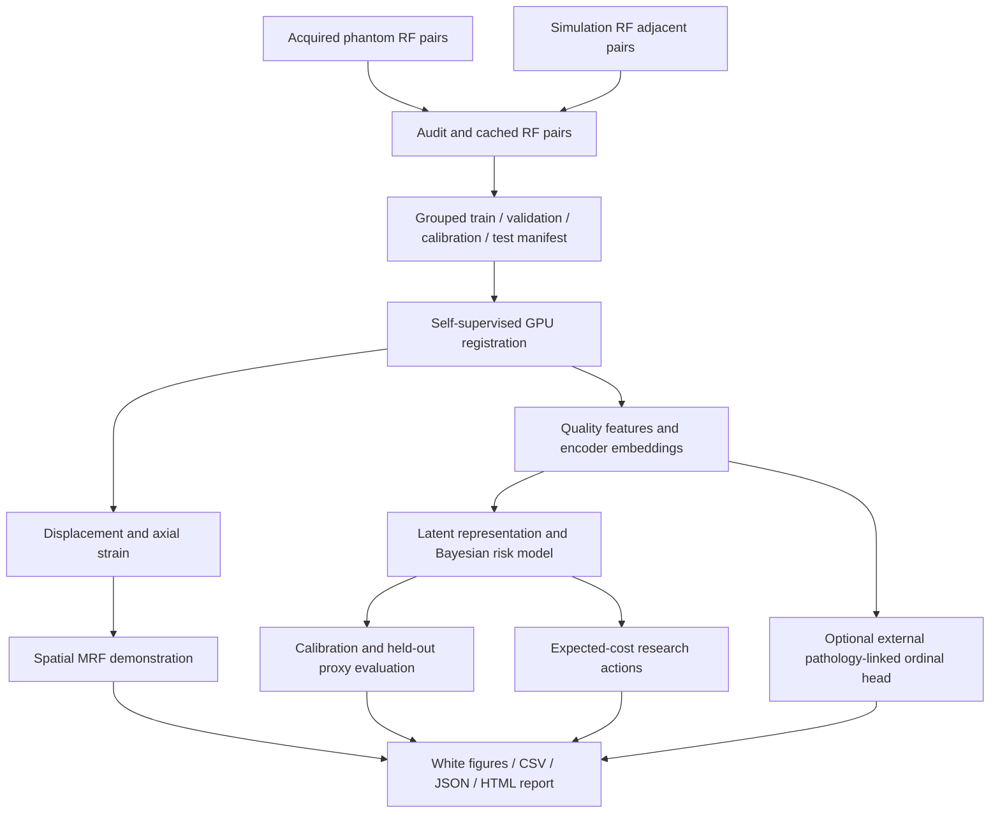

# Label-Free Ultrasound Elastography with Probabilistic Reliability and Risk Analysis for Tumor-Grading Research

This course project combines **ultrasound motion and strain estimation** with every topic in the supplied **MIS course syllabus**. The main implementation is one commented, standalone file: [`elastography_mis.py`](elastography_mis.py). It trains a compact neural registration model on both the acquired phantom and simulation RF data in this folder, builds probabilistic quality models, and produces white-background figures, numerical result tables, and an offline HTML report.

The data supports an elastography and **measurement-reliability** project. It does not contain verified pathology grades. Consequently, the default risk output concerns a declared image-quality rule; it is not a probability of cancer, malignancy, histological grade, or clinical harm. An optional pathology-linked ordinal modeling extension is available when external labels and patient identities are supplied.

The original project idea, **“Ultrasound Elastography for Label-Free Tissue Tumor Grading,”** remains the long-term motivation. The title above states what the supplied data can support today and makes the syllabus contribution explicit. A short presentation title is **“ElastoGrade: Label-Free Elastography and Probabilistic Risk Analysis.”**

## Read this first

- **Use both datasets:** `--domains both` is the default. Both phantom and simulation RF pairs contribute to self-supervised training.
- **One implementation file:** the standalone program does not import the older `src/elastograde` package or require the notebooks. Standard scientific Python dependencies are still required.
- **Preserve the raw data:** preparation writes a separate disk cache. It does not rewrite the MATLAB files.
- **Train before interpreting results:** a working demo or successful GPU check demonstrates software execution, not real-data accuracy.
- **Read the manifest assumptions:** simulation frame ordering and phantom acquisition identities are not established by the array names. Their provisional treatment is recorded and explained below.
- **Risk is an operational proxy:** the Bayesian model learns to reproduce a rule based on reconstruction, cycle consistency, and valid support. Because related features define both its inputs and its target, classification scores measure rule imitation rather than independent displacement accuracy.

The older modular implementation and its 19 notebooks remain useful reference material. See [`src/elastograde`](src/elastograde), [`notebooks`](notebooks), and the [legacy modular README](docs/README_MODULAR_LEGACY.md). Historical execution claims in those documents describe their own code and runs; they should not be transferred to this standalone implementation.

**Current standalone version: 1.1.1.** The expanded [real-data report](reports/mis_verified_pilot_v2/report.html) contains 50 white-background figure pairs from version 1.1. Version 1.1.1 additionally validates original RF precision before conversion and records corrupt-source exclusions so full preparation can continue safely. See [data-quality handling](#corrupt-source-quarantine-and-safe-preparation-restart) for the local data findings and restart procedure.

## Contents

1. [Project question and contribution](#project-question-and-contribution)
2. [Exact syllabus coverage](#exact-syllabus-coverage)
3. [What is actually in the data folder](#what-is-actually-in-the-data-folder)
4. [Install and check the laptop](#install-and-check-the-laptop)
5. [Run the project](#run-the-project)
6. [Training and inference design](#training-and-inference-design)
7. [Probabilistic models and risk analysis](#probabilistic-models-and-risk-analysis)
8. [Results and visualization guide](#results-and-visualization-guide)
9. [Optional pathology-linked grading](#optional-pathology-linked-grading)
10. [Experimental protocol](#experimental-protocol)
11. [GPU memory, runtime, and storage](#gpu-memory-runtime-and-storage)
12. [Troubleshooting](#troubleshooting)
13. [Course report and viva guide](#course-report-and-viva-guide)
14. [Limitations and risk register](#limitations-and-risk-register)
15. [References](#references)

## Project question and contribution

The central question is: **Can an RF registration model estimate useful displacement and strain without motion labels, while probabilistic models make its quality evidence, spatial consistency, and research-use decisions explicit?**

The project has three connected layers:

| Layer | Input | Output | What it contributes |
| --- | --- | --- | --- |
| Elastography | Paired RF measurements | Displacement, reconstructed RF, axial strain, mechanical summaries | The original ultrasound project |
| Probabilistic reliability | Reconstruction and motion-quality features | Latent quality representation, rule-failure probability, spatial quality labels, decision costs | The MIS syllabus |
| Optional grading research | Learned embeddings plus external pathology labels and patient IDs | Ordinal predictions and held-out metrics | A supervised downstream extension of label-free features |

“Label-free” here means the registration network does not need ground-truth displacement or tumor-grade labels to learn from RF pairs. The quality classifier uses a derived proxy target. The optional ordinal head requires actual grade labels. These are different learning problems, and the report should distinguish them.

The intended contribution is an integrated, inspectable course project with explicit assumptions and reproducible experiments. The implementation does not claim a new clinical diagnostic method, a validated causal graph, or state-of-the-art displacement accuracy. A useful result may be that a simple baseline performs as well as the neural model on a particular proxy; report that honestly.

### Data flow



## Exact syllabus coverage

The syllabus is included in the Python file as an explicit mapping, and the mathematics appears in executable functions rather than only in the README.

| Unit | Syllabus topic | Project implementation | Evidence to show in the report |
| --- | --- | --- | --- |
| 1 | Introduction to probabilistic graphical models | A graph represents dependencies among latent quality, observed evidence, and operational failure | Graph and joint factorization |
| 1 | Probabilistic AI | Prediction is represented as a probability conditional on evidence and model assumptions | Posterior risks, calibration, expected costs |
| 1 | Introduction to Bayesian networks | Directed acyclic graph with normalized conditional probability tables | BN figure and fitted tables |
| 1 | Representation learning in Bayesian networks | A latent Bernoulli-mixture quality representation learned with EM; CNN representations provide a complementary continuous view | Latent-state probabilities and representation plots |
| 1 | Inference in Bayesian networks | Exact inference on a small discrete model, including marginalization of hidden states | Posterior examples and numerical consistency checks |
| 2 | Markov networks | Undirected factorization built from the Bayesian model | Moral graph and retained factors |
| 2 | Independencies in Markov networks | Graph separation queries | Explicit conditional-independence demonstration |
| 2 | Hidden Markov models | Log-domain forward/backward inference and Viterbi decoding on a clearly identified illustrative ordered sequence | Filtering, smoothing, decoded states, transition/emission plots |
| 3 | Markov random fields | Image-grid unary costs and pairwise Potts penalties; iterative conditional modes | Raw versus refined quality labels and energy curve |
| 3 | Decision networks | Chance-state probabilities and a declared action-cost matrix | Expected-cost curves and action regions |
| 3 | From Bayesian networks to Markov networks | Moralization and CPD-to-factor conversion, with distribution-equivalence checks | Directed and moral graphs plus numeric equivalence |

The latent graphical-model representation is distinct from the CNN encoder embedding. The first explicitly addresses learning hidden variables in a probabilistic model; the second connects representation learning to the main elastography network. Neither representation identifies tumor grade without pathology-linked evidence.

### Suggested learning outcomes

By the end of the project, you should be able to derive the Bayesian joint distribution, explain how evidence changes a posterior, identify separations in an undirected graph, distinguish HMM filtering from smoothing, formulate an MRF energy, and select an action by minimizing expected cost. You should also be able to explain why a visually attractive strain image does not establish clinical accuracy.

## What is actually in the data folder

The local inventory examined during implementation contains **2,541 MATLAB files**, totaling approximately **57.67 GiB** of MATLAB data. Counts refer to the local files, not a claim about a complete official dataset release.

| Folder | Files | Approximate bytes | Observed arrays | Default treatment |
| --- | ---: | ---: | --- | --- |
| `data/phantom` | 2,294 | 52,329,992,768 | `Data`, `flow_f_init`, `flow_b_init` | Use `Data` RF pairs for self-supervised learning |
| `data/simulation` | 67 | 9,463,618,295 | `RF` in 43 files; `axial` and `lateral` in 24 companions | Use RF pairs for self-supervised learning; inventory displacement companions |
| `data/test` | 180 | 132,746,400 | `rf_pre` | Inventory only; do not silently interpret as paired test ground truth |

### Acquired phantom schema

```text
Data          : [2, 1920, 384]       float32 or float64
flow_f_init   : [1, 2, 1920, 384]    float32
flow_b_init   : [1, 2, 1920, 384]    float32
```

`Data[0]` and `Data[1]` supply the paired RF arrays. Array indexing uses axial samples first and lateral lines second after selecting the pair member. The `flow_*_init` arrays are **initial flow estimates**, not verified reference displacement. The standalone training objective does not use them as labels.

File names do not establish independent acquisitions. Different files may contain overlapping measurements or frames. Without a verified acquisition map, file-level grouping is a provisional engineering split and cannot justify strong generalization claims. A real acquisition grouping CSV should be supplied through `--group-map` when that metadata becomes available.

### Simulation schema

```text
modelN_all.mat          RF: [10, 10, 2048, 256]
modelN_5m_all.mat       RF: [10, 10, 2048, 256]
model25_5m_all.mat      RF: [ 6, 10, 2048, 256]
modelN_Dis_2048_fix.mat axial: [10, 2048, 256]
                       lateral: [10, 2048, 256]
```

There are 24 model IDs, 2 through 25. The `_5m_all` family exists for those 24 models; the `_all` family exists for models 2 through 20. All files, leading-axis slices, and derived frame pairs belonging to the same `modelN` stay in one split, including the two filename families.

The RF leading dimensions require interpretation. The default **working assumption** is `RF[realization, frame, axial, lateral]`, selected by `--simulation-frame-axis 1`. Under this assumption, adjacent frames within one realization create training pairs. Use `--simulation-frame-axis 0` only when source documentation establishes the other leading axis as the frame axis. The manifest records the chosen assumption; the script does not turn a dimension length of 10 into proof of temporal meaning.

The displacement companion arrays have observed names and shapes, but their physical units, reference frame, sign convention, and correspondence to arbitrary RF pairs remain unverified. They therefore do not supervise training or supply reported EPE. Using both datasets does **not** require inventing a displacement interpretation: both can supply label-free reconstruction losses.

By default, at most **20 adjacent pairs per simulation RF file** are cached, covering all source files while limiting duplicated cache storage. `--simulation-pairs-per-file 0` selects every available adjacent pair. This is a pair budget, separate from `--limit`, which caps source files per domain for pilots. Document the selected budget in the course report.

### The folder named `test`

The observed array is:

```text
rf_pre: [96, 96, 10] float64
```

This is not the same schema as the full RF-pair files. The final axis may be an ordered sequence, but its meaning and any pre/post correspondence are not verified. The program inventories these files but does not pair arbitrary filenames or call this folder a pathology-labeled test set. The actual standalone test partition comes from the saved grouped manifest.

### What the files do not establish

The inspected schemas do not establish patient IDs, pathology grades, tumor masks, scanner spacing, physical displacement units, a validated temporal axis, or independent phantom acquisition IDs. The code uses pixel displacement and dimensionless axial strain. It does not manufacture kPa maps or clinical risk scores from missing metadata.

### Cache and manifest

Preparation converts selected RF pairs into float32 `.npy` arrays of shape `[2, axial, lateral]` and writes a manifest. Training memory-maps the prepared arrays and reads patches as needed, so the entire raw dataset is not loaded into RAM or GPU memory.

The manifest contains sample IDs, source paths, domains, groups, split assignments, cache paths, shapes, and preparation notes. Inspect it before a long run. Keep it with the checkpoint: it defines which data was eligible for each partition.

An acquisition-group CSV accepts `source,group` (or `path,group`). Sources are relative to `--data-root`, using forward slashes. The following illustrates the schema only; replace the group values with documented acquisition identities:

```csv
source,group
phantom/Data_1.mat,documented_acquisition_A
phantom/Data_10.mat,documented_acquisition_A
phantom/Data_100.mat,documented_acquisition_B
```

Supply a row for **every selected phantom source** when using `--group-map`. All files from one acquisition must share its group. At least four independent groups per domain must remain after duplicate consolidation. Simulation `modelN` grouping remains mandatory even if an additional CSV group is supplied. Providing a CSV records your grouping evidence; the program cannot independently certify the acquisition identities.

Pairs receive stable IDs of the form `phantom_<content-hash-prefix>` or `simulation_<content-hash-prefix>`. Use the exact IDs from `results.csv` or the cache manifest when linking external pathology labels. `aliases` preserves original filenames and frame selections after exact duplicates are consolidated.

## Install and check the laptop

### Python environment

Use Python 3.12 for the verified setup below. Python 3.11 or later is the project baseline, subject to compatible scientific-package wheels. The original global Python 3.14 installation on this laptop crashed while importing its experimental NumPy build. A separate `.venv-mis` environment was created and tested successfully without modifying that installation.

From PowerShell:

```powershell
Set-Location D:\MIS
py -3.12 -m venv .venv-mis
.\.venv-mis\Scripts\python.exe -m pip install --upgrade pip
.\.venv-mis\Scripts\python.exe -m pip install numpy scipy matplotlib scikit-learn
```

Install PyTorch using the command produced by the [official PyTorch installation selector](https://pytorch.org/get-started/locally/) for **Windows / Pip / Python / the CUDA build compatible with your NVIDIA driver**. Do not install the CPU-only wheel when you intend GPU training. The selector is preferable to copying a CUDA version from an old README because supported wheels change.

You may activate the environment:

```powershell
.\.venv-mis\Scripts\Activate.ps1
```

If PowerShell blocks activation, use `.\.venv-mis\Scripts\python.exe` wherever the commands below use `python`. Activation is a convenience, not a requirement; no machine-wide execution-policy change is needed. When copying the PyTorch selector command, replace its `pip`/`pip3` prefix with `.\.venv-mis\Scripts\python.exe -m pip` so installation goes into this environment.

The single-file pipeline uses NumPy, SciPy, Matplotlib, scikit-learn, and PyTorch. It does not require `pgmpy`, TensorFlow, a notebook server, the older project package, or downloaded pretrained weights.

### GPU check

```powershell
nvidia-smi
python -c "import torch; print('PyTorch:', torch.__version__); print('CUDA available:', torch.cuda.is_available()); print('CUDA runtime:', torch.version.cuda); print('GPU:', torch.cuda.get_device_name(0) if torch.cuda.is_available() else 'CPU')"
python elastography_mis.py doctor
```

A local hardware query during implementation found an **NVIDIA GeForce RTX 5050 laptop GPU with approximately 8 GiB VRAM**. This identifies available hardware; the `doctor` output and an executed pilot establish whether the active Python environment can use it. An NVIDIA GPU appearing in `nvidia-smi` does not by itself prove that the installed PyTorch wheel supports CUDA.

**Current environment:** the project environment now contains `torch 2.15.0+cu132`, detects the RTX 5050 Laptop GPU, and passes CUDA registration forward/backward checks. Earlier version 1.1 reports were generated with the CPU wheel; each report preserves its own environment record.

For the detected **RTX 5050, driver 621.01, Windows, and Python 3.12** configuration, the same-version GPU package is available in the [official CUDA 13.2 wheel index](https://download.pytorch.org/whl/cu132/torch/). The installed driver meets [NVIDIA's CUDA 13.x driver requirement](https://docs.nvidia.com/deploy/cuda-compatibility/minor-version-compatibility.html). The commands below document the GPU setup now verified locally.

```powershell
Set-Location D:\MIS
.\.venv-mis\Scripts\python.exe -m pip install --upgrade "torch==2.15.0+cu132" --index-url https://download.pytorch.org/whl/cu132
```

The explicit `+cu132` replaces the installed `+cpu` build. This project does not use torchvision or torchaudio, so those additional packages are not required. After installation finishes, verify actual GPU computation and gradients:

```powershell
.\.venv-mis\Scripts\python.exe -c "import torch; print(torch.__version__, torch.version.cuda, torch.cuda.is_available()); x=torch.randn(512,512,device='cuda',requires_grad=True); (x@x.T).square().mean().backward(); torch.cuda.synchronize(); print(torch.cuda.get_device_name(0)); print('CUDA forward/backward OK')"
.\.venv-mis\Scripts\python.exe elastography_mis.py doctor
```

Expect `2.15.0+cu132`, `cuda_available: true`, the RTX 5050 name, and `CUDA forward/backward OK`. A short project run then checks the full model and loss on the GPU:

```powershell
.\.venv-mis\Scripts\python.exe elastography_mis.py demo --device cuda --epochs 1 --examples 1 --skip-robustness --cache artifacts/mis_gpu_demo_cache --out reports/mis_gpu_smoke
```

`--device auto` selects an available GPU or CPU. Use `--device cuda` for the full run when you want a clear failure if CUDA is unavailable. This prevents accidentally starting a lengthy CPU training job.

### Check the command interface

```powershell
python elastography_mis.py --help
python elastography_mis.py self-test --out reports/mis_self_test_v2
```

The self-tests check numerical conventions and model interfaces. They do not replace a real-data benchmark. Read the resulting JSON to see which checks actually ran in your environment.

## Run the project

### 1. Audit the real folder

```powershell
python elastography_mis.py audit --data-root D:\MIS\data --out reports/mis_audit
```

The audit inspects available files and schemas before training. Review unexpected shapes, missing variables, selected domains, grouping assumptions, and excluded files. Schema verification is especially important if you later add another archive version.

### 2. Run a small synthetic end-to-end demo

```powershell
python elastography_mis.py demo --device auto
```

The demo trains briefly on analytic synthetic RF-like fixtures and writes `reports/mis_demo/report.html`. Its default patch size, model width, and epoch count are small. It verifies the training, probabilistic, and reporting path without processing the full raw dataset. Every such output is a synthetic software demonstration, not a measured IMPACT result.

### 3. Run a real-data pilot using both domains

```powershell
python elastography_mis.py run --domains both --data-root data --cache artifacts/mis_pilot_cache --out reports/mis_pilot --device cuda --limit 12 --simulation-pairs-per-file 4 --epochs 2 --batch-size 2 --patch 128 96 --width 8 --radius 1 --accumulation 2 --patches-per-pair 1 --steps-per-epoch 20 --validation-batches 4 --eval-limit 80 --examples 4
```

This checks the real MATLAB adapter, storage, GPU memory, training, and report generation with a bounded workload. The source and step limits make it a pilot. Its scores should not be presented as a full-dataset experiment.

Use separate cache/output directories for pilots and the final experiment. This avoids confusing a deliberately limited manifest with the full-data manifest.

### 4. Prepare both domains for the main experiment

```powershell
python elastography_mis.py prepare --domains both --data-root data --cache artifacts/mis_cache --out reports/mis_prepare --simulation-frame-axis 1 --simulation-pairs-per-file 20
```

Inspect `artifacts/mis_cache/manifest.json`. If verified phantom acquisition groups are available, add `--group-map path/to/acquisition_groups.csv` and prepare a fresh cache. The grouping format is documented with the adapter and its validation errors; do not invent groups from adjacent filenames.

Preparation may take significant time and disk space because the MATLAB archives are large and some simulation files are compressed. Pair caching makes repeated epochs faster at the cost of additional storage.

### 5. Train on the GPU

```powershell
python elastography_mis.py train --cache artifacts/mis_cache --out reports/mis_run --device cuda --epochs 50 --batch-size 4 --patch 256 128 --width 12 --radius 2 --accumulation 2 --patches-per-pair 2 --workers 0
```

This configuration is a starting point for an 8 GiB laptop GPU, not a universal fit guarantee. If the pilot indicates insufficient memory, reduce batch size first. The model trains on both domains present in the prepared manifest; `train` does not reconstruct a different manifest from a `--domains` argument.

The best validation checkpoint is saved as `best.pt`; the most recent completed epoch is saved as `last.pt`. Early stopping defaults to 10 epochs without validation improvement. `--patience 0` disables it. Training progress and configuration are written to the output folder.

### 6. Generate the complete report

```powershell
python elastography_mis.py evaluate --cache artifacts/mis_cache --out reports/mis_run --device cuda --checkpoint reports/mis_run/best.pt --eval-limit 0 --examples 8 --mc-samples 8
```

`--eval-limit 0` evaluates all prepared pairs. The default `--eval-limit 400` is a practical reporting subset across partitions and must be described as such. Monte Carlo dropout with `--mc-samples 8` adds repeated inference passes; use 1 for the fastest report. Dropout variation is a model sensitivity estimate, not a calibrated error probability.

### Corrupt-source quarantine and safe preparation restart

Full preparation exposed two corrupt local sources that were outside the initial small pilot:

| Source | Observed problem | Default treatment |
| --- | --- | --- |
| `phantom/Data_208.mat` | Ordinary RF amplitudes mixed with 1,134 values outside float32 range, reaching about `1.24e307`; damaged scanlines affect lateral columns 372–373 | Quarantine the whole source |
| `simulation/model11_5m_all.mat` | Compressed MATLAB payload fails its zlib integrity check | Quarantine the whole source |

Version 1.1.1 checks original precision before float32 conversion. It preserves raw MAT files and records exclusions in `artifacts/mis_full_cache/data_rejections.json`, with source signatures, reasons, diagnostic counts and affected columns where available. Whole-file quarantine avoids inventing RF values or destroying useful dynamic range through clipping or global rescaling. Excluded sources do not enter split assignment or training; their absence remains part of the experiment's provenance. Replace them from a verified source if a complete release is required.

`--invalid-sources quarantine` is the preparation default. Use `--invalid-sources error` for strict stop-on-error behavior. Completed good cache entries are reused. A repaired/replaced source with a changed size or modification timestamp is reconsidered automatically. Existing good caches are checked by their signatures and array headers; the new per-frame constancy checks apply during conversion of newly processed sources.

The complete local preparation was executed successfully: **2,337 selected RF source files**, **2 quarantined files**, **3,133 accepted derived pairs before exact deduplication**, and **3,100 unique cached pairs**. All phantom and simulation sources were visited. The cache and [exclusion audit](artifacts/mis_full_cache/data_rejections.json) are ready; no full training epochs were started as part of this recovery.

From PowerShell, restart the full workflow using the existing cache:

```powershell
.\.venv-mis\Scripts\python.exe elastography_mis.py run --domains both --device cuda --epochs 50 --patience 10 --batch-size 2 --accumulation 4 --cache artifacts/mis_full_cache --out reports/mis_full_training --eval-limit 0
```

Preparation resumes completed sources, then training starts with early stopping and `best.pt`/`last.pt` checkpoints. If training itself has already completed epochs, use the documented `train --resume .../last.pt` command with matching training settings instead of starting a new run into that output folder.

Open `reports/mis_run/report.html` in a browser. It is a local, offline report. PNG files are convenient for slides; PDFs are useful for a written report; CSV and JSON preserve the measurements behind the figures.

### One command for preparation, training, and reporting

```powershell
python elastography_mis.py run --domains both --data-root data --cache artifacts/mis_cache --out reports/mis_run --device cuda --epochs 50 --batch-size 4 --patch 256 128 --accumulation 2 --eval-limit 0 --examples 8 --mc-samples 8
```

For a long experiment, separate `prepare`, `train`, and `evaluate` commands make each stage easier to inspect and rerun. The `run` command is convenient once the pilot succeeds.

### Resume training

```powershell
python elastography_mis.py train --cache artifacts/mis_cache --out reports/mis_run --device cuda --epochs 80 --batch-size 4 --patch 256 128 --width 12 --radius 2 --accumulation 2 --resume reports/mis_run/last.pt
```

`--epochs 80` specifies the desired total epoch count. Resume must retain compatible architecture, manifest, and training settings. Do not resume a checkpoint against changed group assignments or a different cache and call it the same experiment. An interrupted epoch may need to be repeated from the last completed checkpoint.

Version 1.1 records the objective/preprocessing version and the pilot caps `--steps-per-epoch` and `--validation-batches` in the resume contract. A version 1.0 checkpoint can still be inspected/evaluated, with its compatibility note recorded, but it cannot resume as the same version 1.1 experiment. Reuse the RF cache and train into a fresh output folder such as `reports/mis_run_v2`. Evaluating an older checkpoint uses current normalization and must be reported as a changed protocol.

### Full-resolution tiled inference

```powershell
python elastography_mis.py infer --input data/phantom/Data_1.mat --checkpoint reports/mis_run/best.pt --out reports/mis_full_field --device cuda --patch 256 128 --tile-overlap 32
```

You can also supply a cached pair `.npy` with shape `[2, axial, lateral]`, including a simulation pair. Tiling blends overlapping displacement estimates before differentiating strain. It writes `full_field_maps.npz`, `full_field_panel.png`, `full_field_panel.pdf`, and provenance. Inspect seams: patchwise inference does not guarantee globally coherent motion merely because the blended image looks smooth.

When `--patch` is omitted, evaluation and tiled inference inherit the checkpoint's training patch. An implicit tile overlap is reduced for small patches so it remains valid. Every tile uses the same shared pair normalization as training. Both CLI patch dimensions must be at least 32 to retain meaningful correlation-window support.

### Important defaults

| Argument | Default | Meaning |
| --- | --- | --- |
| `--domains` | `both` | Source domains used by preparation |
| `--data-root` | `data` | Raw folder root |
| `--cache` | `artifacts/mis_cache` | Prepared pairs and manifest |
| `--out` | `reports/mis_run` | Checkpoints, figures, and report |
| `--device` | `auto` | Automatic GPU selection or CPU |
| `--seed` | `42` | Reproducibility seed |
| `--simulation-frame-axis` | `1` | Provisional frame axis among the two leading RF dimensions |
| `--simulation-pairs-per-file` | `20` | Adjacent-pair cap; 0 means all |
| `--limit` | `0` | Source-file cap per domain; 0 means all |
| `--invalid-sources` | `quarantine` | Record and exclude corrupt/unrepresentable RF sources; `error` stops strictly |
| `--epochs` | `50` | Maximum total epochs |
| `--batch-size` | `4` | Patches per forward/backward batch |
| `--patch` | `256 128` | Axial and lateral patch dimensions |
| `--width` | `12` | Encoder/refinement channel width |
| `--radius` | `2` | Local correlation search radius |
| `--lr` | `0.0002` | AdamW learning rate |
| `--accumulation` | `2` | Batches per optimizer update |
| `--patches-per-pair` | `2` | Training patch samples per pair per epoch |
| `--workers` | `0` | DataLoader workers; conservative Windows default |
| `--patience` | `10` | Validation early-stopping patience |
| `--steps-per-epoch` | `0` | Training batch cap; 0 means complete loader |
| `--validation-batches` | `0` | Validation batch cap; 0 means complete loader |
| `--eval-limit` | `400` | Report pair budget across splits; 0 means all |
| `--examples` | `6` | Detailed example-map panels |
| `--mc-samples` | `1` | Stochastic dropout passes; 1 disables variance estimation |
| `--robustness-samples` | `3` | Held-out examples for bounded noise/gain/dropout studies; 0 skips these perturbations |
| `--skip-robustness` | off | Skip perturbation and analytic-reference studies for faster report generation |
| `--residual-threshold` | `0.45` | Declared reconstruction-rule threshold |
| `--cycle-threshold` | `1.0` | Declared cycle-rule threshold in pixels |
| `--no-amp` | off | Disable CUDA mixed precision |

## Training and inference design

### Coordinate convention

RF arrays use `[z, x]`, where `z` is the axial sample index and `x` is the lateral line index. The displacement tensor uses channels `[u_x, u_z]` in **pixels**. Warping samples the moving image at:

```text
warped_post(z, x) = post(z + u_z(z,x), x + u_x(z,x)).
```

Thus the flow maps a reference coordinate into the moving image. A positive axial component samples deeper in the moving image. This convention must be checked before comparing with any external flow field. Channel order and array-axis order are intentionally different.

### RF normalization and sampling

Each selected RF pair is normalized consistently and converted to float32. Training draws reproducible random crops that change across epochs. Validation and report evaluation use deterministic crops so changing the crop does not masquerade as model improvement.

Cropping preserves the sampled RF signal and its pixel displacement units. Resizing an oscillatory RF array as if it were an ordinary photograph can alter carrier content and the interpretation of displacement. The prepared pair cache therefore preserves RF spatial dimensions.

### Compact registration model

The network uses a shared encoder for the two RF images, a three-scale feature pyramid, local feature correlations, and coarse-to-fine displacement refinement. A pooled encoder representation is retained for exploratory feature plots and the optional ordinal head.

The local correlation volume searches offsets near the current estimate. Its channel count grows as `(2r+1)^2`, so increasing the radius increases memory and compute. The network is deliberately compact for laptop training. It is a research baseline, not an exact reproduction of a published model or a pretrained medical foundation model.

### Self-supervised loss

The principal signal asks whether the predicted displacement reconstructs the reference RF from the moving RF. Additional penalties encourage smooth flow, forward/backward consistency, and valid deformation behavior:

```text
L = L_reconstruction
  + lambda_smooth * L_smooth
  + lambda_cycle * L_cycle
  + additional validity / folding penalties implemented in the loss.
```

Reconstruction uses local normalized correlation rather than treating arbitrary RF amplitude as a pathology target. Bidirectional consistency compares forward flow with the reverse flow sampled at the corresponding displaced location. Simply adding the two fields at identical pixel indices would generally be incorrect.

The default smoothness and cycle weights are 0.02 and 0.1. Change them only as a declared validation experiment, preserve the run configuration, and compare identical held-out groups. The loss is optimized without the simulation displacement companion arrays and without the phantom initialization flows.

Each pyramid level predicts a residual bounded by two pixels at that level. For dimensions divisible by four, the three levels therefore bound total motion to approximately **14 pixels per direction**. Larger displacements can exceed this compact model's capacity. Check the phase-translation baseline and residual maps rather than treating out-of-range motion as an accurate estimate; a wider-range architecture is a separate research extension.

CUDA automatic mixed precision reduces activation memory. Sensitive loss and warping calculations are handled in float32. Gradient scaling, gradient clipping, accumulation, and checkpointing support stable laptop runs. These facilities improve execution; they do not guarantee that the chosen model or loss is scientifically adequate. See the [official AMP examples](https://docs.pytorch.org/docs/stable/notes/amp_examples.html) for the underlying training pattern.

### Axial strain

For small deformation, axial strain is:

```text
epsilon_zz(z,x) = d u_z / d z.
```

When both displacement and position use matching axial pixel units, their spacing factor cancels and normal strain is dimensionless. The figure displays `100 * epsilon_zz` as a percentage. The implementation uses a local smoothed derivative to reduce noise amplification.

Compression is negative under the stated convention. A field decreasing by 0.2 mm over 10 mm has strain approximately −0.02, or −2%. This is a worked example of units, not a measurement extracted from these files.

Strain is not stiffness in kPa. Unknown stress, boundary conditions, anisotropy, and out-of-plane motion prevent a general conversion from compression strain to absolute modulus. The program does not make that conversion.

### Baselines

The report compares the learned registration against zero displacement and a phase-correlation translation baseline on the same evaluation crops. Zero flow asks whether the model improves on leaving the pair unregistered. Global translation asks whether a simple bulk-motion estimate already explains much of the reconstruction change.

These comparisons use reconstruction proxies. A lower reconstruction residual may accompany an incorrect displacement when RF phase is ambiguous or motion is non-identifiable. Once independently verified reference motion becomes available, add EPE and strain-reference error under a documented coordinate conversion.

### Quality evidence

Quality features summarize reconstruction mismatch, cycle error, strain dispersion, valid support, and other measured mechanical or image statistics defined in the script. The named columns in `results.csv` are the authoritative feature list.

The operational target flags samples that violate a declared quality rule. Its thresholds are configuration values, not learned clinical limits. A model that reproduces the rule accurately may be useful for demonstrating probabilistic inference, but the rule and its learned approximation must not be advertised as independently validated motion failure detection.

## Probabilistic models and risk analysis

### Unit 1: Bayesian networks

A Bayesian network represents a joint distribution using a directed acyclic graph:

```text
P(V_1,...,V_n) = product_i P(V_i | Parents(V_i)).
```

Every conditional-probability table row must be nonnegative and sum to one. The code uses smoothing when estimating discrete probabilities so sparse observations do not automatically create impossible events. The graph encodes modeling assumptions; an arrow alone does not establish a causal relationship.

The model combines discretized quality evidence, a learned latent representation, and the operational failure variable. Feature discretization is fitted on training rows. Applying a median learned from the entire dataset would allow test information to influence the model even if the neural network itself had a clean split.

Inference asks for a conditional probability such as `P(rule_failure = 1 | observed_quality_evidence)`. Hidden variables are summed out. The model is small enough that exact enumeration is practical and offers an independent check of more structured calculations.

### Representation learning with latent variables

A Bernoulli mixture describes binary evidence using a latent component `Z`:

```text
P(x) = sum_z P(Z=z) * product_j P(x_j | Z=z).
```

Expectation-maximization alternates between calculating posterior component responsibilities and updating component probabilities. The resulting representation is a vector of latent-component probabilities. Component numbers are arbitrary: switching component 0 and component 1 does not change the distribution.

Do not rename components “benign” and “malignant.” They may reflect gain, noise, compression, simulation conditions, or other acquisition differences. If a component is described as high-risk, show how its observed evidence differs and retain the qualification that the risk concerns the proxy rule.

CNN embeddings provide a second representation learned from RF reconstruction. PCA and clustering plots are exploratory descriptions. Fitting their transforms on training rows helps preserve the held-out protocol, but an attractive scatterplot is not evidence of tumor-grade separability.

### Calibration

The raw Bayesian probability may not match the observed proxy-rule frequency. A separate calibration partition supports a simple probability calibration step. Training learns the model, validation selects the motion checkpoint, calibration adjusts the probability mapping, and test reports held-out results.

Reliability diagrams compare predicted probability with observed rule frequency. The Brier score measures squared probability error. Calibration can be unstable with few groups, strong dependence, or only one target class. The implementation records unavailable metrics and skips operations that are not estimable rather than presenting a fabricated score.

Calibration against the proxy rule calibrates agreement with that rule. It does not convert the model into a probability of physical displacement error or clinical harm.

### Unit 2: Markov networks and independencies

An undirected graphical model expresses:

```text
P(V) = (1/Z) * product_C phi_C(V_C),
```

where `phi_C` are nonnegative factors and `Z` normalizes the joint distribution. Unlike a Bayesian CPD, an individual Markov factor does not have to sum to one across a child variable.

For a positive undirected model, graph separation gives conditional independencies. In a chain `A—B—C`, conditioning on `B` separates `A` from `C`. This is a graph statement under the model, not proof that the measured variables are independent in the real acquisition process.

The script demonstrates separation explicitly and compares probabilities obtained from the corresponding factorization. These small examples make the syllabus operations inspectable without a large third-party PGM dependency.

### Hidden Markov models

An HMM introduces an ordered latent state sequence:

```text
P(z_1:T, o_1:T) = P(z_1) * product_t>1 P(z_t | z_t-1)
                           * product_t P(o_t | z_t).
```

Forward filtering uses observations up to the current time. Forward/backward smoothing also uses later observations. Viterbi decoding finds one most probable complete state path; it is not equivalent to choosing the most probable smoothed state independently at every time.

The default HMM sequence is an **illustrative ordered demonstration**. Unrelated phantom files are not sorted by filename and rebranded as a time series. Simulation pair preparation uses a documented working frame-axis assumption, but the educational HMM does not silently treat that assumption as verified clinical temporal evidence.

Log-domain calculations prevent long probability products from underflowing. Show the transition matrix, emission matrix, filtered probabilities, smoothed probabilities, and decoded path in the course presentation. The classical basis is Rabiner’s [HMM tutorial](https://www.cs.ubc.ca/~murphyk/Bayes/rabiner.pdf).

### Unit 3: spatial Markov random field

Neighboring image pixels often have related quality, but an independent threshold can produce isolated speckles. A binary Potts MRF balances unary evidence and spatial consistency:

```text
E(l) = sum_i -log P_i(l_i)
     + beta * sum_(i,j) w_ij * [l_i != l_j].
```

Here `l_i` is a quality label, `P_i` is local evidence, and the pairwise term discourages disagreements between neighboring pixels. Image-aware edge weights can reduce smoothing across strong boundaries.

Iterated conditional modes updates labels to reduce this energy. The energy curve checks the optimization behavior. ICM finds a local solution and is not guaranteed to find the global optimum. A smoother map is not automatically more accurate: small high-risk regions can disappear. The report shows raw evidence and refined labels together so the effect remains visible.

The spatial evidence is a quality demonstration, not a calibrated pixelwise cancer map. Sample-level risk calibration does not automatically calibrate every pixel in an MRF.

### Decision networks

Suppose `p` is the estimated probability of operational rule failure. A decision policy compares expected costs:

```text
ExpectedCost(action) = (1-p)*Cost(action, reliable)
                    + p*Cost(action, failure).
BestAction = argmin_action ExpectedCost(action).
```

The illustrative actions are accept the measurement for research analysis, reacquire, or review. Costs are explicitly assumed teaching values, not hospital policy or patient-management recommendations. Changing the cost of accepting a failed measurement moves the decision boundaries even when the probability model stays unchanged.

This distinction is central to probabilistic AI: probability estimation and action selection solve different problems. A threshold of 0.5 is not universally optimal when consequences are asymmetric.

### Converting a Bayesian network to a Markov network

Moralization connects co-parents and removes arrow directions. Each original CPD becomes a factor over its child and parents. Retaining these factors preserves the joint distribution; merely drawing an undirected graph and assigning unrelated potentials does not.

Moralization is not triangulation. It can lose some independence information visible in the original directed graph. The script includes a small distribution-equivalence demonstration, making this final syllabus topic a numerical exercise rather than only a diagram.

For the general relationship among representation, inference, and learning in directed and undirected models, see Koller and Friedman’s [Probabilistic Graphical Models](https://mitpress.mit.edu/9780262013192/probabilistic-graphical-models/).

## Results and visualization guide

All generated scientific figures use a **white figure background**, readable labels, and consistent colors. Image panels may naturally contain dark B-mode pixels; “white background” refers to the figure canvas, axes presentation, and report design rather than changing the measured image content. Each figure is exported as PNG and PDF.

### Main artifacts

| Artifact | What it contains |
| --- | --- |
| `best.pt` | Model selected by validation loss |
| `last.pt` | Last completed training state for resume |
| `config.json` | Run arguments and training choices |
| `evaluation_config.json` | Actual evaluation options, including the resolved checkpoint patch |
| `data_rejections.json` | Source names, signatures, reasons, and diagnostics for any quarantined input files |
| `environment.json` | Python, library, and device information |
| `run_manifest.json` | Data lineage and partition information used by the run |
| `status.json` | Running/completed/interrupted/failed state and runtime/error information |
| `history.json` | Epoch losses, individual training-loss terms, learning rate, elapsed time and throughput |
| `results.csv` | One row per evaluated pair, with features, proxy target, probability, split, and group |
| `summary.json` | Partition metrics, endpoint definitions, counts, limitations, and grouped statistics |
| `risk_model.json` | Learned quality model and calibration parameters |
| `pgm_results.json` | Bayesian/Markov/HMM/decision demonstration outputs |
| `extended_results.json` | Numeric backing data for the expanded plot families and spatial profiles |
| `robustness_results.json` | Frozen-model noise, gain and dropout-strip sensitivity measurements |
| `analytic_benchmark.json` | Fifteen independent known-translation reference-fixture cases and estimator errors |
| `representations.npz` | Embeddings and representation-analysis arrays |
| `example_00_maps.npz`, etc. | Numerical maps behind selected example figures |
| `figures/*.png` and `figures/*.pdf` | White-background plots |
| `report.html` | Offline result gallery with captions, topic search, PDF links and numeric exports |

The report includes a broad collection of plots, subject to data availability. Undefined two-class metrics, unavailable uncertainty estimates, or absent clinical labels are identified rather than fabricated.

### How to interpret the figure families

| Figure family | Question it helps answer | Main limitation |
| --- | --- | --- |
| Dataset and split composition | Which domains and groups were evaluated? | A count is not proof of independent acquisitions |
| Training and validation curves | Did the optimized objective improve? | Loss improvement need not equal displacement accuracy |
| Baseline comparison | Does learned registration improve reconstruction over simple alternatives? | Reconstruction remains a proxy |
| B-mode / displacement / strain panels | What spatial behavior did the model produce? | Visual plausibility is not reference accuracy |
| Reconstruction and cycle maps | Where does the model struggle to explain the RF pair? | Consistent wrong correspondences may evade detection |
| Feature distributions and correlations | Which quality signals vary or move together? | Correlation does not prove causal failure mechanisms |
| ROC and precision–recall | How well is the proxy rule reproduced? | The target is derived from related input features |
| Confusion matrix | Which proxy-rule cases are accepted or flagged at a stated threshold? | The threshold and prevalence affect interpretation |
| Reliability diagram / Brier score | Do predicted probabilities match proxy-rule frequencies? | This is not clinical calibration |
| Risk–coverage curve | What remains when high-risk measurements are rejected? | Rejection can hide difficult subgroups |
| Bayesian graph and tables | How is the joint model represented? | Structure reflects assumptions |
| Latent-component plots | What quality patterns did the probabilistic representation learn? | Component labels have no inherent biological meaning |
| PCA / phenotype plots | What structure appears in learned features? | Embeddings can encode acquisition nuisance factors |
| Moral graph and separation examples | How does directed-to-undirected conversion work? | Educational model properties do not verify real causality |
| HMM sequence plots | How do filtering, smoothing, and decoding differ? | Default sequence is illustrative |
| MRF labels and energy | What does spatial regularization change? | Energy descent is not proof of correct segmentation |
| Decision-cost curves | How do assumed costs change the preferred action? | Cost values are educational assumptions |
| Grouped bootstrap intervals | How variable are group-aggregated endpoints? | Unknown acquisition dependence limits validity |
| Monte Carlo dropout sensitivity | How sensitive is flow to stochastic model masks? | Variance is not calibrated error |
| Failure atlas | What do difficult held-out examples look like? | Examples should complement aggregate results |

### Metrics and unavailable values

ROC AUC and precision–recall metrics need suitable target variation. If an evaluation subset has only one class, some metrics are undefined. A blank/`null` value with an explanation is the correct outcome; substituting 0 or 1 would misrepresent the experiment.

Bootstrap intervals resample groups rather than pixels. They describe the selected manifest grouping and evaluated sample subset. With provisional file-level phantom groups, they remain conditional on an imperfect independence assumption.

For each table or slide, include the data domain, number of groups, number of pairs, crop protocol, checkpoint, and whether evaluation was capped. Keep the report’s endpoint warning when exporting figures into the course submission.

### Expanded plots and controlled robustness studies

The report now adds these measured views to the original syllabus and elastography panels:

- Exact single-feature and progressively revealed BN evidence queries, including inference with missing evidence.
- Paired group-level baseline differences, reconstruction ECDFs, domain boxplots, and a group failure atlas.
- Quality-rule threshold sensitivity, overlapping failure causes, risk-cutoff trade-offs, and calibration-score movement.
- Latent-pattern entropy and phenotype/domain composition, with unordered cluster identities retained.
- Depth profiles with spatial interquartile spread, displacement arrows, signed RF-line alignment, Jacobian determinants, validity masks, and shared-bin strain histograms.

By default, a frozen checkpoint and risk model are tested on up to three held-out diagnostic pairs. Selection rotates through domains and acquisition groups, so a sufficiently large budget covers both phantom and simulation data. Noise is applied at `0, 0.05, 0.15, 0.30` of post-frame RMS; post-frame gain factors are `0.5, 1, 1.5`; centered axial dropout strips cover `0%, 10%, 25%` of image depth. These perturbations occur after the clean pair's normalization to stress acquisition inconsistency. The model and calibrator are never fitted to these cases.

The study records measured quality features, frozen proxy-risk probabilities, displacement change from the clean prediction, common support, rule events, and synchronized inference latency. **Displacement change measures sensitivity, not true error.** Small case budgets and provisional acquisition identities limit interpretation. Shaded ranges across selected pairs are descriptive ranges, not confidence intervals.

A separate fifteen-case analytic benchmark evaluates a continuous synthetic texture at exactly translated coordinates. Five axial shifts (`0, 0.5, 1, 2, 4` pixels, with lateral shift one quarter as large) are combined with three noise levels (`0, 0.1, 0.3` RMS). Known reference-to-moving flow supplies genuine fixture EPE for zero motion, phase correlation, and the neural model on the same truth-defined interior. True strain is zero, so nonzero estimated strain measures a fixture artifact. These are software/reference-fixture results and do not validate acoustic simulation or clinical accuracy.

Generate the expanded report after training:

```powershell
python elastography_mis.py evaluate --cache artifacts/mis_cache --out reports/mis_run --device cuda --eval-limit 0 --examples 6 --mc-samples 8 --robustness-samples 3
```

Use `--skip-robustness` while debugging when you want to skip both controlled studies. `--robustness-samples 0` skips only the held-out perturbations; the independent analytic benchmark remains enabled. Every plotted numeric curve is backed by JSON or NPZ data. The HTML report includes a topic-search box and direct PDF/data links.

## Optional pathology-linked grading

The default pipeline does not output tumor grades. To study the original grading objective, obtain a separately authorized dataset with a defined organ, histological grading system, imaging-to-pathology linkage, and patient identifiers. Binary benign/malignant labels, imaging suspicion categories, stage, and histological grade are different endpoints.

The optional extension accepts a CSV with exact cache sample IDs:

```csv
id,patient_id,grade
EXACT_CACHE_ID_A,PATIENT_001,0
EXACT_CACHE_ID_B,PATIENT_002,1
EXACT_CACHE_ID_C,PATIENT_003,2
```

These rows are a schema example, not supplied patient records. Grades must be contiguous integers `0..K-1`; document the mapping to the actual grading system. Patient IDs must not cross existing data partitions. If they do, the script rejects the fit; rebuild groups before training or evaluating clinical features.

```powershell
python elastography_mis.py evaluate --cache artifacts/clinical_cache --out reports/clinical_research --checkpoint reports/clinical_training/best.pt --device cuda --eval-limit 0 --clinical-labels path/to/pathology_labels.csv
```

The optional model uses train-fitted feature scaling and cumulative logistic heads for `P(G > k)`, with monotone projection to valid ordered probabilities. Training weights prevent patients with many labeled records from automatically dominating the head. All grades must be represented in the training set.

Outputs include `clinical_ordinal_model.json`, `clinical_ordinal_predictions.csv`, and `clinical_ordinal_metrics.json`, with ordinal MAE, accuracy, quadratic weighted kappa, and confusion information when defined. These probabilities are research outputs and are not clinically calibrated by default.

This extension does not solve missing acquisition metadata or create pathology labels for phantom files. The existing phantom and simulation data can develop the mechanics pipeline; they cannot become a clinical grading cohort through a CSV containing invented classes.

## Experimental protocol

### Separate the four data roles

| Partition | Permitted use | Avoid |
| --- | --- | --- |
| Training | Learn neural weights, quality discretization, latent representation, BN parameters, feature transforms | Using test statistics to choose transformations |
| Validation | Select checkpoint and compare declared hyperparameters | Repeatedly selecting based on final test scores |
| Calibration | Fit the risk probability mapping | Calling in-sample calibration a held-out result |
| Test | Report final performance and examples after choices are fixed | Tuning thresholds because a test plot looks better |

Split by the independent experimental unit before extracting derived pairs and patches. Simulation `modelN` grouping keeps model variants together. Phantom file grouping is provisional until a trustworthy acquisition map exists. For clinical work, patient grouping takes precedence over file count.

### Suggested experiments

1. Run the zero-flow and phase-translation comparisons already included in the report.
2. Train the default combined-domain model with a fixed seed and saved manifest.
3. Run declared ablations with `--cycle-weight 0` or a changed smoothness weight, using separate output folders and identical partitions.
4. Compare raw and calibrated quality probabilities on the same held-out subset.
5. Compare raw and MRF-refined quality labels while showing both energy and boundary behavior.
6. Change illustrative decision costs and explain how the preferred action changes.
7. Repeat selected training configurations with different seeds if time permits; distinguish training variation from group-bootstrap uncertainty.

Domain-only training can be explored with separate caches, but independently prepared splits may differ. A fair domain ablation requires explicitly matching shared held-out model/acquisition groups rather than assuming identical seeds produce identical experimental populations.

### Reporting negative results

If the neural model does not beat translation on reconstruction, include the result. If calibration worsens the Brier score on a small test set, report the sample size and uncertainty. If MRF smoothing removes a small region, discuss the tradeoff. These findings are scientifically useful and connect directly to the course’s treatment of uncertainty and model assumptions.

### Reproducibility record

Preserve the final script, Python environment information, raw-data inventory, cache manifest, split/group mapping, arguments, random seed, checkpoints, results tables, and selected figures. Record whether the run used a full epoch, capped steps, all prepared pairs, or a reporting subset. A seed alone does not guarantee bitwise reproducibility across GPUs, drivers, or library versions.

## GPU memory, runtime, and storage

The raw dataset is much larger than GPU memory. That is expected: batches of patches are transferred to the GPU while prepared arrays remain on disk. Dataset size controls total training work and storage; patch size, batch size, network width, and correlation radius control much of the instantaneous GPU memory.

### Practical starting profiles

| Profile | Patch | Batch | Width / radius | Accumulation | Use |
| --- | --- | ---: | --- | ---: | --- |
| Conservative pilot | `128 96` | 2 | `8 / 1` | 2 | Verify the adapter and GPU path |
| Main starting point | `256 128` | 4 | `12 / 2` | 2 | Initial 8 GiB experiment |
| Lower memory | `128 96` | 1 | `8 / 1` | 4 | Recover from memory pressure |

These are starting configurations, not measured performance guarantees for every environment. Increasing accumulation approximates a larger effective batch without storing all of its activations simultaneously. With batch size 4 and accumulation 2, a complete accumulation group contains 8 patch samples; the final group in an epoch may be smaller.

Use `--workers 0` first on Windows. Once the pipeline is stable, test 2 workers and measure whether loading improves; more workers can increase RAM use and disk contention. A fast SSD helps because both raw MATLAB reads and cache reads are substantial.

A float32 phantom pair requires about 5.6 MiB before filesystem overhead. A simulation pair of shape `[2,2048,256]` requires about 4 MiB. Adjacent pairs duplicate shared frames in the cache, so selecting every simulation pair can substantially increase disk usage. Keep the original 57.67 GiB dataset plus enough free space for the chosen cache, checkpoints, and reports.

Before deduplication, the default full cache is approximately **16 GiB** (2,294 phantom pairs and up to 860 simulation pairs). Selecting every adjacent simulation pair raises this to approximately **28 GiB** under the default frame-axis assumption. Preparation checks available disk space before extraction and can resume completed sources. Source and cache size/mtime signatures support fast restart; content hashes establish exact-pair identity. These checks do not authenticate the original download or prove that near-duplicate acquisitions are independent.

Do not predict training hours from file count alone. Measure a representative epoch after preparation, include validation time, and account for early stopping and repeated evaluation. Laptop thermal throttling and power mode can change throughput over long runs.

## Verification recorded for this standalone implementation

The following checks were actually executed on **30 October 2026**, using the separate Python 3.12 environment on Windows. These are software verification and short pilots, not a full-dataset benchmark.

| Check | Recorded result | Evidence |
| --- | --- | --- |
| Complete MAT-header inventory | All 2,541 MAT files inspected; 61,926,357,463 bytes | [`data_audit.json`](reports/mis_audit/data_audit.json) |
| Numerical and adapter self-tests | 59 checks passed in version 1.1.1, including original-precision overflow checks, source quarantine/repair, corrupt compressed MAT handling, GPU gradients, and the earlier numerical/leakage checks | [`self_test_results.json`](reports/mis_self_test_v3/self_test_results.json) |
| Synthetic end-to-end run | One fresh version 1.1 epoch, evaluation, expanded numeric exports, and a generated report; equals-form CLI options exercised | [`Synthetic report`](reports/mis_demo_v2/report.html) |
| Both-domain real-data pilot | Four phantom files and four simulation geometry files; 12 unique RF pairs, two fresh epochs followed by successful resume to epoch three | [`Real RF pilot report`](reports/mis_verified_pilot_v2/report.html) |
| Checkpoint resume | Model, optimizer, scheduler, scaler, epoch history, and RNG state reloaded successfully with the version 1.1 contract | [`Pilot history`](reports/mis_verified_pilot_v2/history.json) |
| Full-field tiled inference | Checkpoint patch inherited automatically; per-tile training normalization; blended displacement followed by strain | [`Tiled output`](reports/mis_tiled_smoke_v2/full_field_panel.png) |
| Perturbation sensitivity | Twenty measured cases across two held-out real-data pairs; frozen model and risk fit | [`Robustness results`](reports/mis_verified_pilot_v2/robustness_results.json) |
| Known-motion fixture benchmark | Fifteen continuous-texture translation/noise cases with known flow and zero true strain | [`Analytic benchmark`](reports/mis_verified_pilot_v2/analytic_benchmark.json) |
| Full real-data preparation | All 2,337 selected RF source files visited; two corrupt sources quarantined; 3,100 unique cached pairs prepared | [`Full manifest`](artifacts/mis_full_cache/manifest.json) |
| GPU training smoke test | RTX 5050 mixed-precision forward/backward training, validation and checkpoint saving succeeded | [`GPU smoke status`](reports/mis_gpu_recovery_smoke/status.json) |

The expanded real pilot generated **50 PNG figures and 50 matching PDFs** with two detailed RF examples. With six available examples and both robustness studies enabled, the report generates **74 figure pairs**. The added plots cover measured evidence queries, failure causes, group comparisons, spatial diagnostics, perturbations, and known-motion accuracy. Figures retain a white canvas and axes background. Actual counts depend on requested examples and enabled studies; `figure_manifest.json` is the authoritative list.

The tiny real pilot produced only failing outcomes under the declared quality rule, so its ROC AUC and average precision are explicitly unavailable. Its phase-translation baseline had a substantially lower reconstruction loss than the briefly trained neural model. This is a useful execution result and a reason to perform the full training and baseline comparison; it is not evidence of neural-model superiority. No full-data training, independently referenced real-data motion accuracy, or clinical tumor-grading validity is claimed.

The earlier CPU reports used NumPy 2.5.4, SciPy 1.18.1, Matplotlib 3.11.2, scikit-learn 1.9.1, and PyTorch 2.15.0+cpu. Version 1.1.1 regression checks and the GPU smoke test used PyTorch 2.15.0+cu132 on the RTX 5050 Laptop GPU. Each generated report/test record retains its own environment and script hash.

## Troubleshooting

### CUDA is unavailable in Python

Check which interpreter is running with `python -c "import sys; print(sys.executable)"`. Then inspect `torch.__version__`, `torch.version.cuda`, and `torch.cuda.is_available()`. A CPU-only PyTorch wheel or a different environment is a common cause. Install a compatible GPU wheel using the official selector, then rerun `doctor`.

### CUDA reports an unsupported device or kernel

Use a PyTorch build that supports the GPU architecture and an appropriate NVIDIA driver. This matters for newer laptop GPUs. Avoid copying an old pinned CUDA wheel solely because an older project used it. The exact error and the environment report are more useful than the GPU marketing name alone.

### Out of GPU memory

Reduce `--batch-size` to 1 or 2, then reduce `--patch`, `--width`, or `--radius` if necessary. Increase accumulation to retain a larger effective batch. Leave AMP enabled unless it causes a diagnosed numerical issue. Close other GPU-heavy applications and rerun the pilot.

### Training loss becomes non-finite

Inspect the failing input for NaN, infinity, constant values, or a schema mismatch. Reduce the learning rate and try `--no-amp` to isolate precision behavior. Do not replace non-finite loss with zero and continue; doing so would conceal a failed experiment.

### The simulation pairing assumption is uncertain

Keep it marked as unverified in the report and inspect source documentation or acquisition code. `--simulation-frame-axis` makes the choice explicit; it does not certify it. Do not enable displacement supervision by guessing units or pairing conventions.

### Only one quality-rule class appears

The current checkpoint, selected subset, and fixed thresholds may classify every crop the same way. Review the feature distribution and report undefined AUC honestly. A larger evaluation subset may provide variation. If you change thresholds, do so as a new declared protocol based on training/validation evidence, not to improve a final test plot.

### The HMM plot looks synthetic

It is an explicitly illustrative ordered sequence by default. That is intentional because independent RF pair filenames do not establish a time series. The demonstration still implements the actual HMM inference algorithms required by the syllabus.

### The report contains fewer plots than expected

Some plots require class variation, multiple samples, Monte Carlo passes, or optional pathology labels. Read captions and `summary.json`. A correctly omitted unavailable metric is preferable to an invented visualization.

### The run is slower than expected

Separate preparation time from training time. Confirm CUDA is active, check whether the machine is throttling, and measure a pilot. Use a smaller evaluation budget while developing the code, then evaluate all prepared pairs for the final report. Do not leave pilot step caps enabled unintentionally in the final run.

### Resume reports a mismatch

Use the same architecture, data/split manifest, and compatible training options as the saved run. If you intentionally changed the experiment, use a fresh output directory and start a new run. Resume is not a mechanism for silently changing the study population.

### An older document contradicts this README

The previous modular documentation was written before these local archives were inspected. It remains a reference for that implementation. For the standalone file, use this README, the current manifest, the script’s `--help`, and the newly generated report as the operative record.

## Course report and viva guide

### Suggested report structure

1. **Problem and motivation:** ultrasound displacement/strain estimation and why quality uncertainty matters for downstream tissue characterization.
2. **Data audit:** actual schemas, counts, available labels, missing metadata, and grouping assumptions.
3. **Elastography method:** RF normalization, registration, warping convention, self-supervised loss, and strain derivative.
4. **Unit 1:** Bayesian representation, EM, CPD learning, and exact inference.
5. **Unit 2:** Markov factorization, graph separation, and HMM filtering/smoothing/Viterbi.
6. **Unit 3:** MRF energy, decision costs, and moralization.
7. **Experiments:** partitions, baselines, hardware, hyperparameters, evaluation budget, and saved provenance.
8. **Results:** measured figures and tables with clearly named proxy endpoints.
9. **Discussion:** failure cases, independence uncertainty, model limitations, and future pathology-linked validation.
10. **Conclusion:** what the actual experiment supports and what remains untested.

### A concise demonstration sequence

Start with the audited data and explain why its labels support mechanics rather than tumor grading. Show one RF pair, the estimated flow, and the strain image. Compare the reconstruction baseline. Then show the BN graph and a posterior, the moral graph and separation example, HMM filtering versus smoothing, MRF refinement and energy, and finally the expected-cost action plot. Finish with one failure example and the missing evidence required for clinical grading.

### Questions you should be ready to answer

| Question | Core answer |
| --- | --- |
| Why is this label-free? | Registration learns from RF reconstruction without supplied motion or pathology labels. |
| Is the risk score cancer risk? | No. It estimates agreement with an explicit operational quality rule. |
| Why use both phantom and simulation data? | Both provide paired RF evidence; they expose the model to different image-generating conditions. |
| Why ignore the simulation displacement arrays? | Their observed shapes do not verify units, sign, reference, or pair correspondence. |
| Why not use `flow_f_init` as truth? | It is an initialization estimate, not an independently verified reference field. |
| What does a BN edge mean here? | A dependency assumption in the probabilistic factorization; causality is not established. |
| What is learned by EM? | Latent component probabilities and evidence distributions under the mixture model. |
| What is the HMM hidden state? | An illustrative latent quality state evolving through an explicitly ordered sequence. |
| How does smoothing differ from filtering? | Smoothing uses future observations; filtering uses only observations so far. |
| Does ICM find the best possible segmentation? | It descends the chosen energy toward a local optimum, not necessarily the global optimum. |
| Why separate calibration? | Probability adjustment should not be fitted on the same observations used for final evaluation. |
| Why can high AUC be misleading here? | The proxy target is constructed from related model input features. |
| Why can a smooth strain image be wrong? | Regularization can hide misregistration, phase ambiguity, or boundary errors. |
| What is required for tumor grading? | Pathology-linked labels, a defined grading system, patient partitions, and appropriate validation. |
| What would make the project stronger? | Verified acquisition groups, verified motion references, external domains, and a properly linked clinical cohort. |

## Limitations and risk register

The term “risk analysis” covers two related activities here: modeling a declared measurement-quality event, and documenting threats to the experiment’s validity. Neither should be confused with a clinical risk assessment.

| Risk | How it could mislead the result | Current response | Remaining limitation |
| --- | --- | --- | --- |
| Phantom acquisition leakage | Related frames appear in different splits | Group-map support and visible provisional grouping | Actual acquisition identities must be supplied |
| Simulation frame-axis error | Unrelated slices are treated as adjacent time frames | Explicit configurable assumption and manifest notes | Source convention remains to be verified |
| Reference displacement mismatch | Incorrect units/sign/pairs inflate or corrupt accuracy | Do not use unverified companion arrays as truth | No real-data reference EPE is claimed |
| Proxy circularity | High classification scores reflect reconstruction of a rule | Explicit endpoint warning and retained raw features | Independent failure detection remains unvalidated |
| RF phase ambiguity | Wrong flow reconstructs a periodic signal well | Cycle, smoothness, and multiple baseline views | Consistent wrong correspondences remain possible |
| Out-of-plane motion | No valid in-plane warp explains the pair | Quality evidence and failure examples | Cannot recover unobserved 3D motion |
| Excessive regularization | Small structures or local failures disappear | Raw/refined panels and ablation options | No verified lesion-mask endpoint is supplied |
| Calibration instability | Probabilities appear precise with few independent groups | Separate calibration split and unavailable-metric handling | Dependence and domain shift can invalidate calibration |
| Selective reporting | Rejected difficult examples disappear from the narrative | Risk–coverage curves and failure atlas | Full cohort/subgroup context is still needed |
| Domain imbalance | The larger domain dominates training | Domain counts and per-domain result views | Balanced sampling would need a declared additional experiment |
| Unsupported clinical interpretation | Mechanical clusters are called grades | Optional labels-only ordinal extension and explicit unavailable default | No pathology cohort is included |
| Tiled inference seams | Patch boundaries introduce strain artifacts | Blend displacement before differentiation and inspect full-field maps | Global motion consistency is not guaranteed |
| Small demonstration runs | A smoke test is presented as a benchmark | Separate demo/pilot/full output folders and provenance | Full training must be executed and assessed |

The deliverable is a complete implementation and documentation package for running the study. Numerical performance claims should come from the saved outputs of the run you actually execute. Do not substitute illustrative HMM data, synthetic demo scores, or historical modular reports for measured full-data results.

## References

- **Probabilistic graphical models:** Daphne Koller and Nir Friedman, *Probabilistic Graphical Models: Principles and Techniques*, MIT Press, 2009. [Publisher page](https://mitpress.mit.edu/9780262013192/probabilistic-graphical-models/).
- **HMM inference:** Lawrence R. Rabiner, “A Tutorial on Hidden Markov Models and Selected Applications in Speech Recognition,” *Proceedings of the IEEE*, 1989. [Paper PDF](https://www.cs.ubc.ca/~murphyk/Bayes/rabiner.pdf).
- **Ultrasound self-supervised adaptation context:** Ali K. Z. Tehrani, Morteza Mirzaei, and Hassan Rivaz, “Semi-Supervised Training of Optical Flow Convolutional Neural Networks in Ultrasound Elastography,” 2020. [Author paper on arXiv](https://arxiv.org/abs/2007.01421). This motivates the broader learning setting; the standalone model is not claimed as an exact reproduction.
- **PyTorch installation:** [Official local installation selector](https://pytorch.org/get-started/locally/).
- **Mixed precision:** [Official PyTorch AMP examples](https://docs.pytorch.org/docs/stable/notes/amp_examples.html).
- **Acquired phantom source recorded in the original project:** [Concordia IMPACT acquired elastography dataset](https://users.encs.concordia.ca/~impact/ultrasound-elastography-dataset-for-unsupervised-training/).
- **Simulation source recorded in the original project:** [Concordia IMPACT simulation database](https://users.encs.concordia.ca/~impact/ultrasound-elastography-simulation-database/).

The two IMPACT web pages returned server-side PHP errors when checked during this implementation. The schema statements in this README therefore come from the local file audit, not from a newly verified description on those pages. Preserve the original download provenance and data-use terms. The repository’s code license does not automatically license redistribution of the RF datasets.

